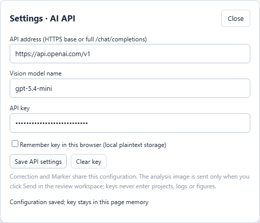

# GelFigure v1.5.0

**Prepare editable DNA/protein gel figures in your browser, with local editing, AI-assisted review and automatic lane correction and marker labelling.**

[简体中文完整教程](README.zh-CN.md) · [Open the web app](https://biosickqiuence.github.io/GelFigure/) · [Download the complete offline HTML](https://github.com/BiosickQiuence/GelFigure/releases/download/v1.5.0/GelFigure-v1.5.0.html) · [Release downloads](https://github.com/BiosickQiuence/GelFigure/releases/tag/v1.5.0)

> No programming is required. Local editing, manual correction and exports need no API account, Python or Node.js. A vision API is needed only if you choose AI recognition.

## Open a gel and prepare a figure

1. Open the web app, or download **GelFigure-v1.5.0.html** from Releases and double-click it in Chrome, Edge, Firefox or Safari. Do not download only the repository’s `index.html`: that file depends on neighbouring folders.
2. Drop a gel image into the window or select Open image. Common images and TIFF are supported; multiple exposures can be imported together.
3. Check Gel type. This release follows a colour rule: sufficient blue selects protein; monochrome selects DNA. Manual selection remains available, so choose protein yourself for a monochrome protein gel.
4. New imports retain original colours and tones. Select Grayscale explicitly if adjustments are needed; saved projects retain their saved appearance.
5. Check the crop, lanes and Marker, then edit names, groups and annotations and export.
6. Save a `.gelfig` project to continue later. A PNG is not an editable project; browser caches are not permanent backups.

## Features

- Manual four-corner perspective correction, orientation, rotation, crop and lane/annotation editing.
- Optional AI lane correction with editable positions, blank/uncertain proposals and explicit adoption.
- One top-of-workspace Marker model choice shared by local and AI recognition; selected sizes, exact positions and label visibility remain editable.
- Sequential top-to-bottom / largest-to-smallest size pairing. Missing positions stay empty; surplus positions remain stored but hidden. Counts are disclosed; bands are not invented.
- Always-visible export readiness badge, thumbnails and SHA-256 deduplication in recent projects (demo gels excluded).
- Undo, recent projects, appearance-only templates, PNG/TIFF/SVG/editable PPTX and review ZIP packages with originals, projects, processing records and hashes.

Review weak bands, empty lanes, model choices and mismatches yourself. This is not a band-repair, background-subtraction or quantitative-analysis tool.

<a id="api-setup"></a>
## First-time AI setup: three fields, no code

An API lets GelFigure ask your chosen service to inspect an image. Choose **one provider**, then obtain all three fields from that same provider. Access to a chat website or a chat subscription is not an API key or proof of API quota; check the provider’s API console.

| GelFigure setting | What to enter | Common mistake |
|---|---|---|
| API address | An HTTPS **OpenAI-compatible Chat Completions** base URL from the table below | A chat website, account dashboard, `/responses` or native `/messages` endpoint |
| Vision model name | The exact API ID, for example `qwen3-vl-plus` | A marketing label, translated display name or text-only model |
| API key | The complete key created in that provider’s API console | A login password, verification code, project ID or another provider’s key |



### Step 1: obtain a provider key

- **Alibaba Cloud Model Studio**: Sign in to the [console](https://bailian.console.aliyun.com/), select your region (e.g. China North 2 / Beijing), and create a key via the [official key guide](https://help.aliyun.com/zh/model-studio/get-api-key). Keys, models and endpoints must match the same region.
- **OpenAI API**: Sign in to [API Platform](https://platform.openai.com/), create a project key under API Keys ([quickstart](https://developers.openai.com/api/docs/quickstart)), and check API billing/quota. GelFigure already contains the calling code, so no programming commands are needed.
- **Google Gemini API**: Open [Google AI Studio API Keys](https://aistudio.google.com/apikey) ([guide](https://aistudio.google.com/docs/api-key)) and use the OpenAI-compatible base URL below.

### Step 2: enter the settings in GelFigure

1. Click **Settings** in the top-right corner, choose a provider preset, and paste your API key.
2. Click **Save API settings** and optionally **Test connection**.
3. Leave Remember key unchecked on shared lab computers (keys stay in memory only and never enter projects or exports).

### Recommended vision models

Choose one provider below (see **[docs/models.md](docs/models.md)** for the full OpenAI Astra/Sol/Terra/Luna catalog, older compatible IDs, Responses-only exclusions, deprecation schedule, and custom gateway notes):

| Provider | API address | Recommended models | Note |
|---|---|---|---|
| Alibaba Model Studio (Beijing) | `https://dashscope.aliyuncs.com/compatible-mode/v1` | `qwen3-vl-plus`, `qwen4-max` | Match the key’s region |
| OpenAI | `https://api.openai.com/v1` | `gpt-6.2-sol`, `gpt-6.2-astra` | Sol for everyday balance; Astra for quality first |
| Google Gemini | `https://generativelanguage.googleapis.com/v1beta/openai` | `gemini-4-hydrogen`, `gemini-3.5-flash-lite` | OpenAI-compatible base required |

A trailing `/` is optional; GelFigure appends `/chat/completions` automatically.

### AI automatic processing & review

After saving API settings, open **AI automatic processing**, drop one gel image and select its marker model. GelFigure locates corners and lanes, expands tight corners locally to retain edge lanes, labels marker bands, and opens the editable figure. Manual editing and AI review workspaces remain available anytime.

## Troubleshooting

| Error / symptom | Check first |
|---|---|
| 401 / invalid key | Complete key, no whitespace/quotes, correct provider, not expired. |
| 403 / permission | Account region, project/model access and key/endpoint region. |
| 404 / model not found | Missing `/v1` or Gemini `/openai`, misspelled ID, or inaccessible model. |
| 429 / quota | Provider quota, billing and rate limits; do not repeatedly click Send. |
| Network / CORS / certificate | Try the official base and web app; lab gateways must allow browser CORS (and `Origin: null` for offline HTML). |
| 90-second timeout | Try a smaller copy or check service load, then retry. |
| Wrong lanes, bands or model | Verify type, orientation, selected sizes and coordinates manually. |

Report bugs via the in-app GitHub feedback button or [Issues](https://github.com/BiosickQiuence/GelFigure/issues/new/choose). Never post API keys or unpublished gels publicly.

## Images, privacy and exports

- Local editing, detection, project restoration and exports run in your browser. AI recognition sends analysis PNGs only when you explicitly request it.
- Keys never enter projects, processing records or image exports.
- Original file bytes are retained; geometry and lane removals are disclosed in processing records. Check effective DPI when assessing source resolution.

## Development and validation

The app has no runtime dependencies. Development tests use Node.js 22+ and Playwright:

```text
npm ci
npx playwright install chromium firefox webkit
npm test
node scripts/bundle-onefile.mjs
```

The standalone build is `dist/GelFigure.html`. See [CHANGELOG](CHANGELOG.md), [docs/models.md](docs/models.md), and [SECURITY](SECURITY.md).

## Acknowledgements

This project builds on [poplarity/GelFigure](https://github.com/poplarity/GelFigure). BiosickQiuence maintains the v1.x adaptations and releases in this repository; original copyright notices and MIT terms are retained in [LICENSE](LICENSE).
