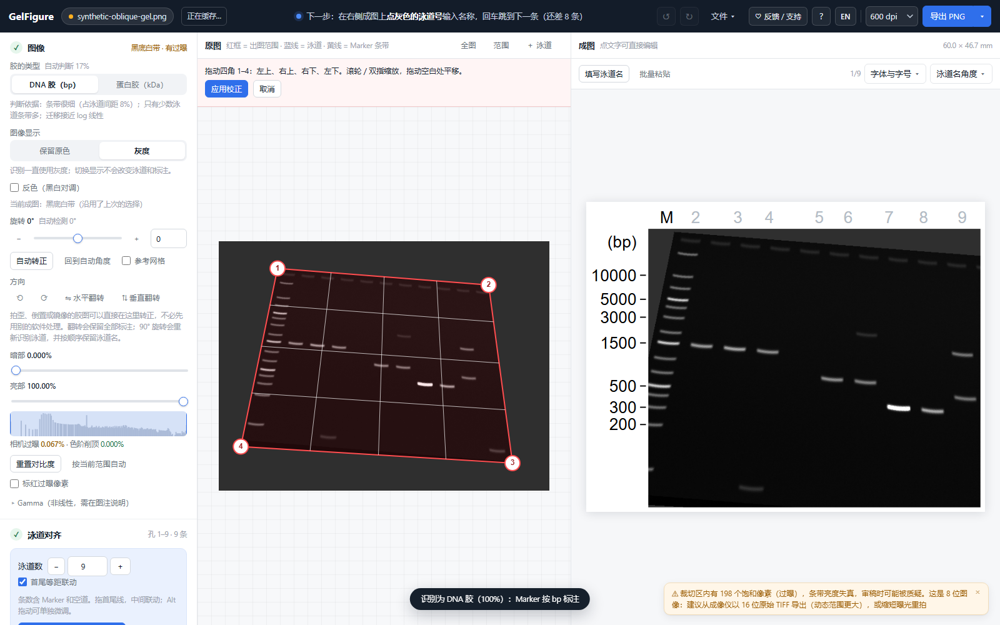
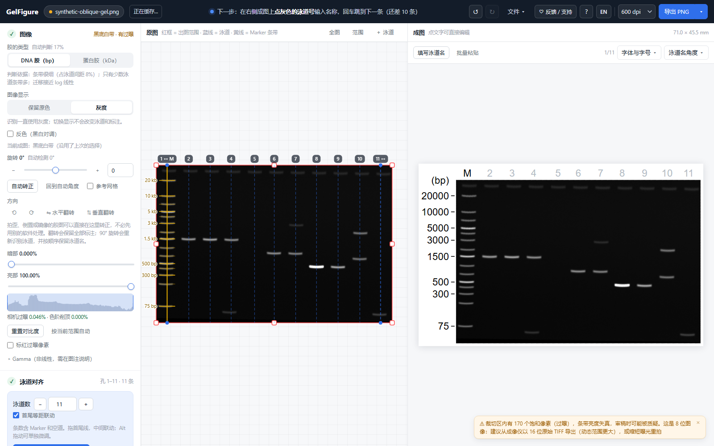

<div align="center">

# GelFigure — Four-point perspective correction

**Turn a raw DNA or protein gel image into a publication-ready figure — in your browser, offline.**

[**Download this fork (ZIP)**](https://github.com/BiosickQiuence/GelFigure/archive/refs/heads/main.zip) · [中文说明](README.zh-CN.md) · [Upstream project](https://github.com/poplarity/GelFigure)

[](https://github.com/BiosickQiuence/GelFigure/actions/workflows/ci.yml)
[](LICENSE)


</div>

## Quick start

**This fork adds manual four-point perspective correction to upstream GelFigure v0.6.15. Use this repository's files to try it; the upstream website and upstream release HTML do not include this fork's changes.**

1. **[Download this fork as a ZIP](https://github.com/BiosickQiuence/GelFigure/archive/refs/heads/main.zip)** and extract the whole archive.
2. Open **index.html** in Firefox, Chrome, Edge or Safari. Keep the adjacent **css/** and **js/** folders together with it; downloading index.html alone is not sufficient.
3. Choose a gel image. For an oblique photograph, use **Lane alignment → Four-point perspective correction** before entering names or annotations. On a phone, find it in **Settings**.
4. Check the lanes and marker labels, enter lane names, then export your figure.

After downloading and extracting the files, image processing works offline in the browser. No AI API key, backend or runtime dependency is required. Automatic recognition uses local image-processing algorithms and the bundled ladder catalogue.

**Prefer one HTML file?** From a source checkout, run `node scripts/bundle-onefile.mjs` (Node.js 22+). Open the generated **dist/GelFigure.html** in your browser; that file includes all application scripts and styles and can be used offline on its own. Node.js is needed only to build it, not to use it.

**Keep your work:** use **File → Save project** before closing. On a phone it is under **⋯** (or **Export → Save project**). The **.gelfig** file contains the original image and editing state, including the correction parameters.

Upstream resources: [original project](https://github.com/poplarity/GelFigure), [original online app](https://poplarity.github.io/GelFigure/), and [upstream releases](https://github.com/poplarity/GelFigure/releases). These links refer to the upstream version. Its illustrated opening guide is available in [English](docs/getting-started.md).

## Four-point perspective correction

Rectify a photograph of a flat gel by selecting a convex quadrilateral and mapping it to a rectangle. The four corners are chosen manually; the operation runs locally with no AI model or network request.

1. Import an image and click **Lane alignment → Four-point perspective correction**. The mobile interface switches from Settings to Image automatically.
2. Drag corners **1 top-left, 2 top-right, 3 bottom-right, 4 bottom-left** onto the photographed plane's boundaries. Use the wheel/pinch to zoom and drag away from handles to pan. Crossed, concave or out-of-image selections are rejected.
3. Click **Apply correction** and review the confirmation. **Existing lane names, annotations, groups, conditions and removed-lane settings are cleared**, then lanes and markers are detected again. Correct the image before annotating it.
4. Inspect the result and continue with the ordinary red crop frame, naming and export. **Ctrl/⌘+Z** undoes the whole correction; redo restores it. **Cancel** or **Escape** leaves the project unchanged.

Original file bytes are retained. Float32 grayscale analysis and RGB display share the same geometry. Repeated corrections sample decoded-source pixels rather than repeatedly resampling the previous corrected raster. Projects, local history and same-size exposure changes retain the correction parameters. The processing log records source corners, original/output dimensions and bilinear interpolation; legend notes disclose the projective transform.

**Limits:** output width and height are estimated from the longer opposing edge lengths. Without known dimensions or camera calibration, this does not establish the true physical aspect ratio. The operation corrects planar perspective, not lens distortion or a curved gel. Use the original data for quantitative analysis. **Uncropped image** exports the corrected image before the regular rectangular crop; **Original data** exports the complete original photograph.

Synthetic example: four-corner selection (left), corrected image and re-detected lanes (right).

<p> </p>

**Validation (2026-11-16):** the local full regression passed 240 checks in each of Chromium, Firefox and WebKit (720 total); the final perspective suite passed seven checks in each engine (21 total). Coverage includes analytic sampling, invalid selections, pointer cancellation, undo/redo, original-byte preservation, projects, RGB/grayscale geometry, orientation, same-size exposures and offline touch interactions. Images are synthetic; this fork has not been validated on real experimental gels or physical phones. These are local results, not a claim about a later GitHub Actions run.

See [the correction details and limitations](docs/perspective.md) and [the regression tests](tests/perspective.mjs).


Drop in the image from your gel imager or scanner. GelFigure works out whether it is a DNA (agarose) or a protein (SDS-PAGE) gel, straightens and crops it, finds the lanes, identifies the ladder and labels its band sizes in bp or kDa. You type the lane names on the figure and export. Everything happens in the browser; **gel images stay local, nothing is installed**.

<p align="center"></p>

## Contents

- [Four-point perspective correction](#four-point-perspective-correction)
- [Features](#features)
- [Quick start](#quick-start)
- [Versions](#versions)
- [Privacy](#privacy)
- [Supported input](#supported-input)
- [What is detected automatically](#what-is-detected-automatically)
- [Exports](#exports)
- [Image integrity](#image-integrity)
- [Built-in ladders](#built-in-ladders)
- [Browser support](#browser-support)
- [Known limitations](#known-limitations)
- [Development](#development)
- [Contributing](#contributing) · [Citing](#citing) · [Acknowledgements](#acknowledgements) · [License](#license)

## Features

**clearer layout settings and release history.** Layout is a normal, expanded sidebar section (Settings on a phone). A short notice introduces a new version once in this browser, without blocking work; importing an image dismisses it. Open **Release history** from the start page, **File**, **Help** or phone **⋯** to see bilingual highlights for each version and the version currently running. The summaries work offline; remembering a seen version requires available browser storage. Development builds are labelled explicitly.

**red annotations.** Click an arrow/symbol, region box, side bracket or side text and choose **Colour → Red**. Box frames, labels and enlarged copies share the colour; group labels colour their line and condition labels colour the whole row. Lane names support red on a selection or the whole name using the inline toolbar. Click a marker label to colour one size or that marker's labels/ticks/unit. **Default** restores the normal colour (white boxes on dark gels). Colour is saved in projects/history and applicable style fields, and retained in PNG, TIFF, SVG and editable PowerPoint. A grayscale gel with red annotations exports as RGB TIFF; source pixels and detection are unaffected.

**feedback and support are always available.** Use **Feedback / support** in the desktop top bar, or **⋯ → Feedback / support / Star** on a phone, even before loading an image. Export reminders return on the next export after being closed. The online form needs no GitHub account: FormSubmit forwards your message, optional reply email and app version to the author. Failed submissions keep your text. Local HTML files offer copy/open-online fallback because this service requires a web page. Alipay support and GitHub Stars are optional. Hidden marker-label columns no longer create a blank strip beside arrows.

**individual lane names and text formatting.** Shared name settings remain the default. Click a name, expand **Individual lane settings** and enable custom size/angle only when needed; untick it to follow the shared settings again. Select text and use Upright, Italic, x² or x₂; with no selection the action applies to the whole name. Clear restores the shared face. Formatting travels with projects/styles and stays editable in PowerPoint. After exporting, you can leave feedback or optionally support the author via the provided Alipay QR. Viewing or saving the QR does not replace your figure; payment is never opened automatically.

**Lane-name angles and header layout.** Export stays at the upper right on smaller desktop windows. Use **Name angle** above the figure for presets or any whole-degree angle from 0–90°. **Auto (default)** keeps the existing spacing rule; selecting it again restores automatic layout. The choice is saved with projects and styles and used by every export format.

**Direct lane and marker editing.** Drag the red frame to crop. Lane count and **Re-detect lanes + markers in crop** are directly available on the left (Settings on a phone). Drag the ↔ end guides for even spacing, or a middle guide to shift the grid. Re-detection runs both stages, preserves confirmed marker choices/manual anchors and respects removed marker roles; simply cropping does not reclassify lanes. Naming, bulk paste and typography live beside the figure. Select a marker lane and ladder, then **Detect bands here** to align only that lane. A compact reference card stays beside the original image: preview a model, select a size and click its actual band. Click a marker number on the figure for font, show/hide and delete controls. Hiding keeps calibration; deleting removes the anchor too. Predicted bands without a detected match are hidden initially; check the result against your image. Existing projects retain their saved geometry; edits are undoable.

**Recent projects.** Open locally cached work from the top bar, File menu, or **⋯ → Recent projects** on a phone. Importing another gel keeps the previous project. Rename, delete or restore its crop, annotations, fonts, colours and all exposures without re-detection. The old single draft migrates automatically; storage failures are reported. History belongs to this browser and can disappear when site data is cleared. Save a `.gelfig` backup for the selected exposure and its annotations, and keep the other original exposure files separately. Cached images are not embedded in the downloaded HTML.

**Local marker library.** Custom models added manually or imported from projects/templates are cached with their favourites, independently of gel images. Reopening the same site/file in the same browser restores them before detection. Existing local models migrate automatically; the Marker section reports whether saving succeeded. If one storage method fails, an independent backup is tried. **Back up marker library / Import marker library** lets you move models to another browser, computer or offline HTML version; it merges models without replacing existing definitions and contains no images. Clearing browser data or private browsing can still remove local caches, so keep the small JSON backup.

- **Fully automatic first draft**: straightening (±15°), crop, lane detection, ladder identification and size labels, linear contrast.
- **DNA and protein gels**: the gel type is recognised on import (colour, band width, band count, migration curve) and the matching mode opens — ladder library, tolerances and units (bp / kDa). A switch at the top of the Image panel overrides the guess without losing names, groups or arrows.
- **Edit on the figure itself**: click a lane name and type, Enter jumps to the next lane; drag across lane names to draw a group line; click cells to cycle `+` / `−`. IME-safe for Chinese, Japanese and Korean input.
- **Lanes numbered by well**: cropping only selects which wells are shown, so names, markers and groups are never lost when you change the crop.
- **Annotations papers use**: group lines, `+`/`−` rows, region boxes (optionally enlarged beside the figure), side brackets for smears or (Ub)n, side text for the stain or antibody, and `*` / `#` / `†` marks for non-specific bands or other products.
- **Labels that never collide**: group labels too wide for their line wrap (or shrink, or stay on one line — your choice) and otherwise move up a row; Shift+Enter breaks a label by hand; any label, arrow or box can have its own font size.
- **System-font choices**: Fonts & sizes above the figure offers Arial, Times New Roman, Helvetica, Calibri and Cambria. Measurement, wrapping, raster/SVG/PPTX exports and saved projects/styles follow the selection. No font files are downloaded or embedded; devices without the chosen font use a substitute, including when opening editable SVG/PPTX files elsewhere.
- **Compact marker-unit headings**: bp/kb/kDa stay beside the gel's upper edge instead of moving above the condition matrix. Condition rows keep their normal spacing; extra clearance is added only when a label would collide.
- **Grayscale by default, original colour available**: newly imported images start in grayscale. For stained protein gels or coloured markers, choose Image → Original colour to retain source colours. Switching display leaves detection and annotations unchanged; saved projects reopen in their saved mode. Original-colour mode keeps rotation/crop without grayscale contrast, inversion or gamma. PNG, SVG, PPTX, uncropped images and RGB TIFF follow the chosen display mode.
- **Target-band arrows with sizes**: click a band; the arrow snaps to it and its size is estimated from the marker(s). Sizes outside the ladder, or where two markers disagree by more than 10 %, are marked `≈`.
- **Several exposures at once**: drop all exposures of one gel; the best one (least saturation, best signal-to-noise) is chosen, and you can switch with all annotations kept.
- **Rotation keeps annotations in place**: lanes, bands, arrows and the crop box rotate with the image.
- **No need to straighten images elsewhere**: mirror horizontally or vertically, and turn 90° either way, inside the Image section. Mirrors and 180° carry every annotation with the image; a 90° turn re-detects the lanes in their new direction and keeps the names you typed, in order.
- **Lane names hug the gel**: condition rows stack above them, so adding rows never pushes a marker lane's name away from the image. The older order (conditions nearest the gel) is one switch in Layout.
- **Side text anywhere along its edge**: left, right and below-the-gel captions can be moved along the edge, by slider or by dragging them on the figure.
- **Lane removal with splice marks**: select a lane and press `H`; a splice gap or line is added and recorded. Empty lanes are suggested for removal (never removed silently). `Delete` / `⌫` deletes a wrongly detected lane.
- **Live lane alignment**: change the count on the left (Settings on phones; include marker and empty lanes), then drag the two end guides; the middle follows evenly. Turn off linking or Alt-drag for an independent correction. The visible crop re-detection button finds both lanes and markers.
- **Pre-flight check before export**: camera saturation, contrast clipping, effective resolution below 300 dpi, tiny fonts, extrapolated sizes, with one-click fixes.
- **Reproducible**: project files (`.gelfig`) contain the original image and every setting; reusable style templates; local project history can restore work after a reload when browser storage is available.
- **Works on a phone**: a bottom bar switches between Image, Figure and Settings; **Export** offers every format and resolution. Pinch to zoom the image, tap a lane to nudge, cut or delete it. Double-tap an existing marker lane to open its editor; add lanes explicitly with **+ Lane**. Marker panels can be moved by dragging the title. An exported PNG opens as a picture you long-press to save to Photos (this also works inside WeChat, which cannot download files) or send through the share sheet.
- **Bilingual interface**: English and Chinese, switchable at any time. Figures are always in English.

## Versions

This fork adds four-point perspective correction on top of upstream **v0.6.15**. The application retains the upstream version identifier; the fork-specific changes are described above and in [CHANGELOG.md](CHANGELOG.md).

The upstream base version is **0.6.15** (desktop Safari fixes, clipboard images, per-item text weights, free text boxes and reliable lane-number exports). The 0.6 series adds protein gels, annotations, and mobile support. 0.6.3 ships a single-file offline build (`GelFigure-<tag>.html`) for double-click use; 0.6.4 reworks the phone layout (bottom bar, export sheet with every format, long-press to save, touch editing); 0.6.5 keeps group labels from overlapping (wrap / shrink / one line), adds typed line breaks and a font size per label. 0.6.7 added editable PowerPoint export with adjustable image crops. 0.6.8 added original colour, system fonts and compact marker-unit headings. 0.6.9 added local project history and automatic recovery. 0.6.10 simplified lane/marker editing and added marker-library caching and grayscale imports. 0.6.11 kept desktop exports right-aligned and added adjustable lane-name angles. 0.6.12 added per-lane text formatting, in-app feedback and support, and compact arrow spacing. 0.6.13 added red annotations, an expanded layout section and local release history. 0.6.14 added whole-image orientation, gel-hugging lane names and freely placed side text. Earlier versions are kept as tags and branches if you need to go back: `v0.6.14` ([`release/0.6.14`](https://github.com/poplarity/GelFigure/tree/release/0.6.14)), `v0.6.13` ([`release/0.6.13`](https://github.com/poplarity/GelFigure/tree/release/0.6.13)), `v0.6.12` ([`release/0.6.12`](https://github.com/poplarity/GelFigure/tree/release/0.6.12)), `v0.6.11` ([`release/0.6.11`](https://github.com/poplarity/GelFigure/tree/release/0.6.11)), `v0.6.10` ([`release/0.6.10`](https://github.com/poplarity/GelFigure/tree/release/0.6.10)), `v0.6.9` ([`release/0.6.9`](https://github.com/poplarity/GelFigure/tree/release/0.6.9)), `v0.6.8` ([`release/0.6.8`](https://github.com/poplarity/GelFigure/tree/release/0.6.8)), `v0.6.7` ([`release/0.6.7`](https://github.com/poplarity/GelFigure/tree/release/0.6.7)), `v0.6.6` ([`release/0.6.6`](https://github.com/poplarity/GelFigure/tree/release/0.6.6)), `v0.6.5` ([`release/0.6.5`](https://github.com/poplarity/GelFigure/tree/release/0.6.5)), `v0.6.4`, `v0.6.3`, `v0.6.2`, `v0.6.1`, `v0.6.0` and `v0.5.0`.

## Privacy

GelFigure is a static web page; image processing does not use a server. Images are decoded and processed by JavaScript in your browser, and results are saved by your browser's own download mechanism.

The [Content Security Policy](index.html) allows the app’s own resources and one explicitly configured feedback endpoint. Image processing, editing and export do not upload gels. Only clicking **Send feedback** submits the text you wrote, optional reply email and app version through FormSubmit; no image, filename, lane names or project is attached automatically. Feedback requires internet access. Sponsorship/Star links open only when clicked. Preferences, custom ladders and autosaved projects (including images, annotations, history and all exposures) stay in browser-local storage. Delete individual projects from Recent projects or clear the browser's site data. Cached data is not written into the downloaded HTML.

## Supported input

| Format | Notes |
|---|---|
| TIFF (8 / 16 / 32-bit grayscale, RGB, palette) | Uncompressed, LZW, Deflate and PackBits; little- and big-endian. Detection uses grayscale. A separate 8-bit RGB display retains RGB/palette colours; TIFF RGB values are treated as sRGB (embedded ICC profiles are not applied, and trigger a notice). Original file bytes are kept intact. |
| PNG / JPG / BMP | Read as 8-bit by the browser; a warning suggests using the raw 16-bit TIFF instead. |
| `.gelfig` | GelFigure project file. |

Both bright-bands-on-dark (EtBr, SYBR, fluorescence) and dark-bands-on-light (Coomassie, scanned films) images are handled. One **Invert** checkbox swaps black and white, and the panel always says what the figure currently looks like.

## What is detected automatically

| Step | How |
|---|---|
| Straightening | Searches ±15° for the angle that makes wells and bands horizontal. Larger angles can be set by hand (±45°), with a reference grid. For perspective (keystone) distortion, use this fork’s manual **Four-point perspective correction**; corners are not detected automatically. |
| Perspective correction | Manually select four corners and rectify the plane with a projective transform and bilinear interpolation. Applying resets annotations and re-detects lanes/markers; original bytes and undo are retained. |
| Crop | The gel slab is found from the well row and the band region; the default crop includes the wells. |
| Lanes | Combines band signal, the gel slab edges and the shape of the wells (template matching), so edges are not mistaken for lanes and empty wells are still found. Where lanes run together (crowded protein gels), the top of the gel, where samples have not spread yet, corrects the spacing. If detection is still wrong, place the two end lanes and space the rest evenly, or re-detect inside the red box only. |
| Gel type | DNA or protein, from the image itself: blue-dominant colour (Coomassie) and broad bands point to protein, thin bands and many evenly spaced ladder bands to DNA, and the curvature of the migration curve votes too. The reasons are shown under the switch. Protein bands are detected with wider smoothing and tolerances; prestained markers are accepted from 4 bands up. |
| Marker lanes | Lanes that a ladder explains completely — not simply the lanes with the most bands, which on a protein gel are the lysates. Several markers on one gel share one migration curve and are matched jointly against the built-in ladders of the gel type (favourites are preferred). |
| Band sizes | Robust fit (RANSAC + polynomial) with order-preserving assignment; dragging one band re-fits the others around it. |

## Exports

| Export | Content |
|---|---|
| PNG | Rendered at the chosen dpi (300 / 600 / 1200). Includes `pHYs` (resolution), `sRGB` and an embedded processing summary (`iTXt`, UTF-8). |
| TIFF | LZW with resolution tags and a processing summary. 8-bit RGB when the figure contains image or annotation colours; otherwise 8-bit grayscale. |
| SVG | Vector text and lines; edit in Illustrator or Inkscape. |
| PPTX | Finished figure with native editable text/shapes and recroppable pictures. Retains uncropped, processed pixels inside the file. See [PowerPoint export](docs/pptx.md). |
| Uncropped image | Same rotation and contrast as the figure, with the crop box, well numbers and removed lanes marked. For the supplementary information. |
| Original data | The untouched source file, byte-identical, with its SHA-256 in the file name. |
| Processing log (JSON) | Source SHA-256, rotation, linear levels, saturation and clipping statistics, effective resolution, removed lanes and why, ladder fit scores, how each arrow size was estimated. |

The **Layout** section shows the **effective resolution** of the gel itself (gel pixels ÷ printed width). If it is below 300 dpi, GelFigure tells you the largest width that keeps 300 dpi and offers to apply it. Total figure width can be set directly to a journal column (85 / 120 / 180 mm).

## Image integrity

GelFigure follows common journal image policies (e.g. Nature, PLOS, JBC; see Rossner & Yamada, *J Cell Biol* 2004, "What's in a picture?"):

- Brightness/contrast adjustments are **linear and whole-image by default**. Gamma is locked at 1 unless explicitly unlocked, and is then reported in the legend notes.
- **Optional perspective correction is geometric resampling**, disclosed in the processing log and legend notes. Keep the original photograph and use original data for quantitative analysis; rectification does not guarantee physical aspect ratio or publication-policy compliance.
- **Camera saturation** (the raw data is already clipped, so you need to re-image) is reported separately from **contrast clipping** (caused by the display settings and fixable).
- Removed lanes get a visible **splice gap or line**, and suggested legend text is generated. Never splice lanes from different gels into one panel.
- Every export carries a processing summary; the uncropped image and the original file can be exported for the supplement.

GelFigure helps you comply, but **you remain responsible** for following your journal's policy.

## Built-in ladders

**DNA ladders** (23): Thermo Scientific GeneRuler: 1 kb, 1 kb Plus, 100 bp, 100 bp Plus, 50 bp, DNA Ladder Mix, Low Range, Ultra Low Range, Express · NEB: 1 kb, 100 bp, 1 kb Plus · Takara: DL2000, DL5000, DL15000 · TransGen: Trans2K, Trans2K Plus, Trans2K Plus II, Trans5K, Trans15K · Tiangen: Marker D2000 · Yeasen: GoldBand 1 kb, GoldBand 100 bp Plus.

[`docs/ladders.md`](docs/ladders.md) lists each one with its catalogue number, band count and reference bands — and the few whose band sizes are identical, which no algorithm can tell apart (mark the one you use as a favourite).

**Protein ladders** (41, kDa, apparent molecular weights): Bio-Rad Precision Plus (Dual Color, All Blue, Kaleidoscope, Unstained, Dual Xtra) · Thermo / Invitrogen (PageRuler, PageRuler Plus, Unstained, Spectra Multicolor, Novex Sharp, SeeBlue Plus2) · NEB · Abcam · GenScript · Yeasen · Epizyme · Beyotime · TransGen · Solarbio · Sangon. Prestained sizes are calibrated in a Tris-glycine system and shift with gel percentage and buffer, so a size read from one is an estimate; the pre-flight check reminds you to write "apparent molecular weight" in the legend.

Any other ladder can be added under **Marker → Custom ladder**; custom ladders travel inside style and project files. To add a ladder for everyone, see [CONTRIBUTING.md](CONTRIBUTING.md).

## Browser support

Current Chrome, Edge, Firefox and Safari 16.4+ on Windows, macOS and Linux. The test suite runs in Chromium, Firefox and WebKit on every change. The v0.6.15 desktop interface and PNG export were also checked in Safari 27.0 on macOS.

When the downloaded HTML is opened directly from disk, some browsers disable IndexedDB for local files; editing and export still work, but local project history may be unavailable. Use the online version or "Save project" if you need it.

## Known limitations

If the page looks like plain text and unstyled buttons, its stylesheet has not loaded or page styles have been disabled. Reload with Ctrl+Shift+R (Command+Shift+R on macOS). For this fork, extract the [**whole ZIP**](https://github.com/BiosickQiuence/GelFigure/archive/refs/heads/main.zip) and keep `css/` and `js/` beside `index.html`, or build `dist/GelFigure.html` as described above. The repository’s `index.html` alone is not a standalone app; upstream release HTML files do not include this fork’s correction feature.

If browser storage is blocked or full, the app can still edit and export. Preferences and custom ladders stay in the current tab only; use **Save project** before closing. Local project history and automatic recovery depend on the browser allowing IndexedDB.

- Automatic detection has been validated on DNA agarose gels, Coomassie-stained SDS-PAGE gels and synthetic gels. On a crowded protein gel whose lanes touch, lane detection can merge neighbours — set the lane count in the left panel (Settings on phones), then align the two end guides. If detection fails on your images, please [open an issue](https://github.com/poplarity/GelFigure/issues/new/choose).
- Band quantification (densitometry) is not supported.
- Bio-Rad `.scn` / `.1sc` and other proprietary formats must be exported to TIFF first. BigTIFF is not supported.
- 16-bit PNGs are read as 8-bit by browsers.

## Development

This section is for contributors editing the source. To use this fork, follow the ZIP or single-file build steps above. Source checkouts keep `css/` and `js/` beside `index.html`; those files must stay together.

No build step and no dependencies: the app is plain HTML, CSS and JavaScript loaded with ordinary `<script>` tags, so it also runs from `file://`.

```
index.html          the page
css/style.css       styles
js/storage.js       optional preferences with in-memory fallback
js/i18n.js          interface language (L('中文', 'English') pairs)
js/tiff.js          TIFF decoder            js/engine.js    image analysis
js/ladders.js       ladder library          js/render.js    figure layout (SVG)
js/export.js        PNG / TIFF / SVG / logs js/app.js       state, pipeline, undo, projects
js/perspective.js   four-point selection and source-based projective rectification
js/editor.js        raw-image canvas        js/ui.js        side panel and top bar
js/figedit.js       editing on the figure   js/demo.js      synthetic test gel
js/uitest.js        interaction self-test   test/test.html  engine self-test
tests/run.mjs       runs both self-tests in Chromium, Firefox and WebKit
```

Run the tests:

```bash
npm install
npx playwright install chromium firefox webkit
npm test                      # all three engines
npm test -- --browser=chromium
```

Or open `test/test.html` (`"allOk": true`) and `index.html?demo=1&uitest=1` in a browser.

## Contributing

Bug reports, gel images that break detection (only if you are allowed to share them), new ladders, translations and code are welcome. See [CONTRIBUTING.md](CONTRIBUTING.md).

## Citing

If GelFigure helped with a publication, please cite it; see [CITATION.cff](CITATION.cff) or use GitHub's "Cite this repository" button.

## Acknowledgements

GelFigure is designed and developed by [poplarity](https://github.com/poplarity). This fork is maintained under [BiosickQiuence/GelFigure](https://github.com/BiosickQiuence/GelFigure) and adds four-point perspective correction and bilingual usage documentation. The upstream attribution and MIT license are retained.

Development is supported by API tokens provided by **Zhao Bowen** ([@zhober](https://github.com/zhober)).

## License

[MIT](LICENSE)
