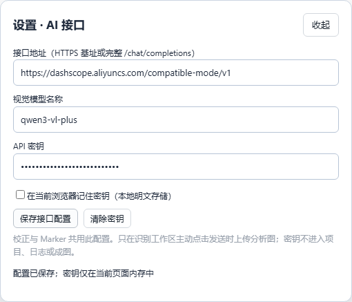

# GelFigure v1.0.0

**把 DNA 胶、蛋白胶整理成可编辑、可导出的实验图。支持本地处理，以及可选的 AI 泳道和 Marker 复核。**

[English](README.md) · [打开网页版](https://biosickqiuence.github.io/GelFigure/) · [下载完整离线 HTML](https://github.com/BiosickQiuence/GelFigure/releases/download/v1.0.0/GelFigure-v1.0.0.html) · [全部下载](https://github.com/BiosickQiuence/GelFigure/releases/tag/v1.0.0)

> 不会编程也能用。普通整理、手动校正和导出不需要 API，也不需要安装 Python、Node.js 或其他软件。只有使用 AI 看图时，才需要准备自己的视觉 API。

## 先打开，再导入胶图

1. 直接打开上面的网页版；或者在 Release 中下载 **GelFigure-v1.0.0.html**，双击，用 Chrome、Edge、Firefox 或 Safari 打开。不要只另存仓库中的 `index.html`，它依赖旁边的其他文件。
2. 将胶图拖进窗口，或点“打开图片”。支持常见图片及 TIFF；多张曝光可一起导入再比较。
3. 核对左侧“胶的类型”。本版按用户选定的颜色规则处理：检测到可靠蓝色时按蛋白胶，黑白图按 DNA 胶；仍可手动切换。黑白蛋白胶应自行选择“蛋白胶”。
4. 新图默认保留原色和原始明暗。需要灰度调整时再主动切换。已有项目恢复其保存的显示选择。
5. 核对裁切红框、泳道数与 Marker，填写泳道名、分组或标注，再导出。
6. 继续编辑请保存 `.gelfig` 项目。PNG 等成图不能替代项目文件；关闭网页前先保存。浏览器缓存不等于永久备份。

## 本版可以做什么

- 手动四点透视校正，适用于斜拍胶图；支持方向、旋转、裁切、泳道与逐条标注编辑。
- 可选 AI 泳道校正：先给出位置和空道建议，人工检查后再应用。
- AI Marker 与本地比较共用工作区：顶部选一次型号，两种识别共同使用。可选择需要标注的大小、修改真实坐标、隐藏某条标签。
- 默认按条带从上到下、大小从大到小顺序配对。缺失的位置留空，多余的位置保留但不显示，并提示数量不一致；不会补造条带。
- 应用结果后自动返回主界面并适配预览，无需重新选择 DPI；保留预览缩放、DPI 与 Marker 坐标。
- 支持撤销、历史项目、仅版式模板、PNG / TIFF / SVG / 可编辑 PPTX，以及含原图、项目、记录和校验清单的审阅 ZIP。

AI 建议需要人工复核，尤其是弱带、空道、型号、缺失条带和误匹配；本工具不提供条带修补、背景扣除或定量分析。

<a id="api-setup"></a>
## 第一次配置 AI：只需要填写三个格子

“API”可以理解为 GelFigure 向你选择的 AI 服务请求看图的通道。请先选定一家服务商，再从**同一家服务商**取得下面三项。网页版、聊天软件会员和 API 控制台是不同入口；能在聊天网页看图，不代表已经有可用的 API Key 或 API 额度。

| GelFigure 设置中的字段 | 应填写什么 | 常见错误 |
|---|---|---|
| 接口地址 | 服务商提供的 HTTPS **OpenAI 兼容 Chat Completions** 基址，示例见下表 | 填成聊天网站、控制台网址、`/responses` 或原生 `/messages` 接口 |
| 视觉模型名称 | 完整、大小写准确的 API 模型 ID，如 `qwen3-vl-plus` | 填模型的中文显示名，或使用不支持图片的文本模型 |
| API 密钥 | 从该服务商 API 控制台创建的完整 Key | 填登录密码、手机验证码、项目 ID，或另一家服务商的 Key |



### 第一步：选一家服务商，获得 Key

**方式 A：阿里云百炼 / Model Studio。**

1. 打开[百炼控制台](https://bailian.console.aliyun.com/)，登录并按平台提示开通模型服务。
2. 先确认地域。下面的简单示例使用**华北 2（北京）**，API Key、模型权限和接口地域必须对应。
3. 进入 API Key 管理，创建 Key，选择有相应模型权限的业务空间。按[官方 API Key 教程](https://help.aliyun.com/zh/model-studio/get-api-key)完成；新 Key 可能只完整显示一次，应在创建时自行妥善保存。
4. 到控制台确认自己有可用额度或计费设置，并能使用 `qwen3-vl-plus`。费用、免费额度和可用地区以平台控制台为准。
5. 将北京区兼容基址、模型 ID 和 Key 填入 GelFigure。若控制台给出业务空间专属域名，请优先使用控制台的完整基址；**不要原样复制带 `{WorkspaceId}` 的占位地址**。官方说明现有 `dashscope.aliyuncs.com` 域名仍可使用。

**方式 B：OpenAI API。**

1. 打开 [OpenAI API Platform](https://platform.openai.com/)，登录，选择或建立自己的 API 项目。
2. 在 API Keys 页面创建项目 Key，并在 API 计费/额度页面确认能发起模型请求。不要把聊天会员登录信息当成 API Key。
3. 接口填 `https://api.openai.com/v1`，模型可先填 `gpt-5.4-mini`，Key 填刚创建的值。若账号没有该模型权限，在控制台确认权限后再使用下表其他型号。
4. 参考[官方 API 入门](https://developers.openai.com/api/docs/quickstart)。本工具已经完成调用代码，**你不需要执行教程里的编程命令**。

**方式 C：Google Gemini API。**

1. 打开 [Google AI Studio 的 API Key 页面](https://aistudio.google.com/apikey)，按页面提示选择或创建项目并取得 Gemini API Key；参见[官方密钥教程](https://aistudio.google.com/docs/api-key)。
2. 在项目中确认模型可用及额度/计费状态。学校或机构账号可能需要管理员开放项目权限。
3. 接口一定使用下表的 **OpenAI 兼容基址**，不要填 Gemini 聊天网页或原生 `:generateContent` URL。模型可填 `gemini-4-hydrogen`。

### 第二步：在 GelFigure 中填入并保存

1. 打开 GelFigure，点击**右上角“设置”**。不需要先导入图片。
2. 将选定服务商的接口地址、完整模型 ID 和 Key 分别粘贴进三个输入框。不要在 Key 前加 `Bearer `，不要加引号、空格或换行。
3. 点击**“保存接口配置”**。布局与 Marker 共用这套配置。
4. 初次使用建议不勾选“在当前浏览器记住密钥”。此时 Key 只保存在当前页面内存，关页后需重填；接口地址和模型名称可以保存。
5. 在自己的私人电脑上可主动选择记住，但这是浏览器本地明文存储。共享电脑不要勾选；需要时点“清除密钥”。项目和成图不会携带 Key。

### 第三步：用一张不保密的胶图试一次

1. 导入一张允许上传的胶图，核对胶类型与方向。
2. 打开 AI Marker，先在**最上方**选择 Marker 型号，再点**“发送图像并识别”**。选择型号、打开设置和生成本地比较结果本身都不会上传。
3. 等待结果，再核对泳道、每条大小与坐标。必要时修改勾选或坐标，再点“应用这份结果”。识别完成不等于已经应用。
4. AI 泳道校正也使用同一配置：先复核角点、泳道、空道和不确定项，再按页内提示应用。
5. 应用后直接返回正常大小的主预览，再保存项目或导出。

## 可以填写哪些看图模型？

**本工具需要“看图片并返回文字/JSON”的视觉理解模型，不是用来生成新图片的文生图模型。** 以下为截至 **2026-11-17** 官方资料确认支持图像输入，并提供本工具所需接口形式的明确 ID。先选一行即可，不需要注册全部平台。

| 服务商 | “接口地址”示例 | 可直接填写的模型 ID | 使用提示 / 官方出处 |
|---|---|---|---|
| 阿里云百炼（北京） | `https://dashscope.aliyuncs.com/compatible-mode/v1` | `qwen3-vl-plus` | [官方 Vision 兼容示例](https://help.aliyun.com/zh/model-studio/qwen-vl-compatible-with-openai)直接使用此 ID；Key 和地域要一致。 |
| 阿里云百炼（北京） | 同上，或控制台提供的同地域业务空间基址 | `qwen4-max` | [官方视觉理解示例](https://help.aliyun.com/zh/model-studio/vision)使用的图像输入模型；先确认账号权限。 |
| OpenAI | `https://api.openai.com/v1` | `gpt-5.4-mini` | [官方模型卡](https://developers.openai.com/api/docs/models/gpt-5.4-mini)列有 Image 输入与 Chat Completions。 |
| OpenAI | `https://api.openai.com/v1` | `gpt-5.4` | [官方模型卡](https://developers.openai.com/api/docs/models/gpt-5.4)列有相同所需能力。 |
| Google Gemini | `https://generativelanguage.googleapis.com/v1beta/openai` | `gemini-4-hydrogen` | [官方兼容接口的图像示例](https://aistudio.google.com/docs/openai#image-understanding)使用此 ID。 |
| Google Gemini | 同上 | `gemini-3.5-flash-lite` | [官方模型卡](https://aistudio.google.com/docs/models/gemini-3.5-flash-lite)确认 Image 输入、Text 输出；走上述兼容接口。 |

基址结尾的 `/` 可有可无，工具会补上 `/chat/completions`；也可以粘贴包含该路径的完整接口地址。模型 ID 随服务商更新，表中没有把已弃用的旧型号当作新手默认选择。

**兼容验证的含义：** 已核对官方模型/接口资料，并对上述三家示例接口做了不带 Key、无图像的浏览器跨域预检，允许本项目网页版来源。这里不等于用付费 Key 逐一实测了胶图准确率；实际调用仍依赖账户权限、额度、地区、服务商策略以及合法 JSON 输出。不要把任何兼容模型的结果当成实验事实。

第三方中转或实验室自建服务也可配置，但请向管理员一次索取：完整 HTTPS 基址、能接收 Base64 图片的模型 ID、Key，以及允许浏览器访问的说明。只写“支持 OpenAI”不一定够，还需支持图像 `image_url`、非流式 Chat Completions、标准 `choices[].message.content` 和 JSON 回复。不要把原生 Claude `/messages`、DashScope 原生接口、Gemini 原生接口或图片生成端点直接填进本工具。

## 配置失败时，先按这个表排查

| 提示或现象 | 优先检查什么 |
|---|---|
| 401 / invalid API key | Key 是否完整、是否误带空格/引号，是否属于当前接口平台，是否失效。 |
| 403 / 无权限 | 账号地区、项目权限、模型权限与 Key 地域是否匹配。 |
| 404 / model not found | 基址是否少了 `/v1` 或 Gemini 的 `/openai`，模型 ID 是否拼错，账号是否可用此模型。 |
| 429 / quota | 到服务商控制台检查额度、账单和调用频率；不要连续点击。 |
| 网络、CORS、证书或重定向错误 | 先试官方基址；尝试网页版。向中转/自建服务管理员确认支持当前网页来源和离线文件的 `Origin: null`。不要关闭浏览器安全设置。 |
| 图片不支持 / 参数无效 | 可能选了纯文本、语音、文生图模型，或用了不兼容协议。按模型表重新配齐同一家的三项。 |
| 90 秒超时 | 本工具已取消，不会自动重试。先用较小的另存副本检查网络和服务负载，再主动重试；不要覆盖实验原图。 |
| 不是 JSON、截断、坐标/型号校验失败 | 尚未应用。换用支持指令与结构化文字输出的视觉模型，或联系接口提供方；不要把错误输出强行当结果。 |
| “项目已变化，草稿过期” | 识别期间改图、旋转、切项目或改型号后，旧结果不能再应用，需要重新识别。 |
| 识别位置/型号不对 | 先核对原图方向、胶类型、型号和条带勾选，再人工微调。连通成功不代表识别正确。 |

遇到问题，可从网页“GitHub 反馈”或[本仓库 Issues](https://github.com/BiosickQiuence/GelFigure/issues/new/choose)提交说明，需要 GitHub 账号。可提供浏览器、报错文字与去敏后的步骤；**不要公开 API Key、保密胶图或未发表数据**。

## 图像、隐私与导出

- 日常编辑、传统本地识别、项目恢复和导出在浏览器内进行。只有主动发送 AI 识别时，才向你填写的接口发送完整分析图 PNG 以及所选型号（未指定则发送当前类型目录）。
- AI 的“完整分析图”经过当前透视、方向和旋转处理，但**不等同于只发送红框内区域**，不包含界面、泳道名、文字标注或项目文件。上传前检查整张输入图是否允许分享。
- Key 不进入项目、处理记录或图像导出。外部服务如何保留图像由其政策决定。
- 原始文件字节保留；几何校正、剪道和相关处理在记录中说明。PNG/TIFF 的文件 DPI 与胶图有效 DPI 是不同指标；看“胶图有效 DPI”评估原图分辨率。
- 网页不再提供赞助二维码、支付链接或第三方反馈转发，也不弹出版本新增功能/历史界面。反馈和 Star 只在主动点击后打开本仓库 GitHub 页面。

## 开发与验证

网页运行无需依赖；仅开发测试需要 Node.js 22+ 与 Playwright：

```text
npm ci
npx playwright install chromium firefox webkit
npm test
node scripts/bundle-onefile.mjs
```

`dist/GelFigure.html` 是构建后的单文件。v1.0.0 包括颜色/显示、AI 协议、人工保护、撤销、项目、预览适配、导出和手机模拟回归；测试使用合成图与拦截响应，不宣称真实胶图或每家视觉 API 的实测准确率。详细发布记录见 [CHANGELOG](CHANGELOG.md)，安全说明见 [SECURITY](SECURITY.md)。

## 致谢

本项目基于 [poplarity/GelFigure](https://github.com/poplarity/GelFigure) 改进，感谢原项目提供的胶图处理、标注和导出基础。本仓库由 BiosickQiuence 维护 v1.0.0 的改造与发布，原始版权声明和 MIT 许可保留在 [LICENSE](LICENSE)。
